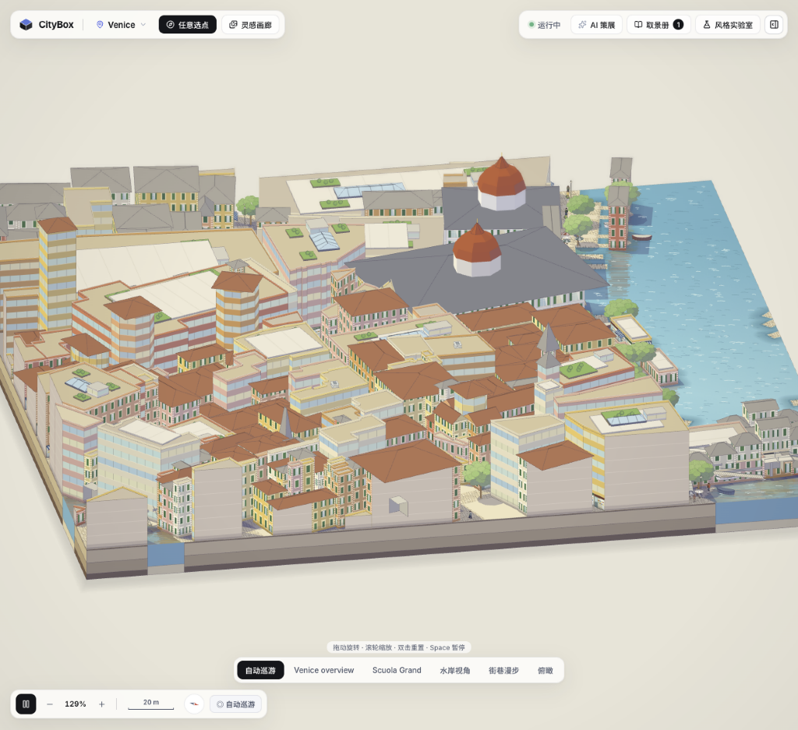
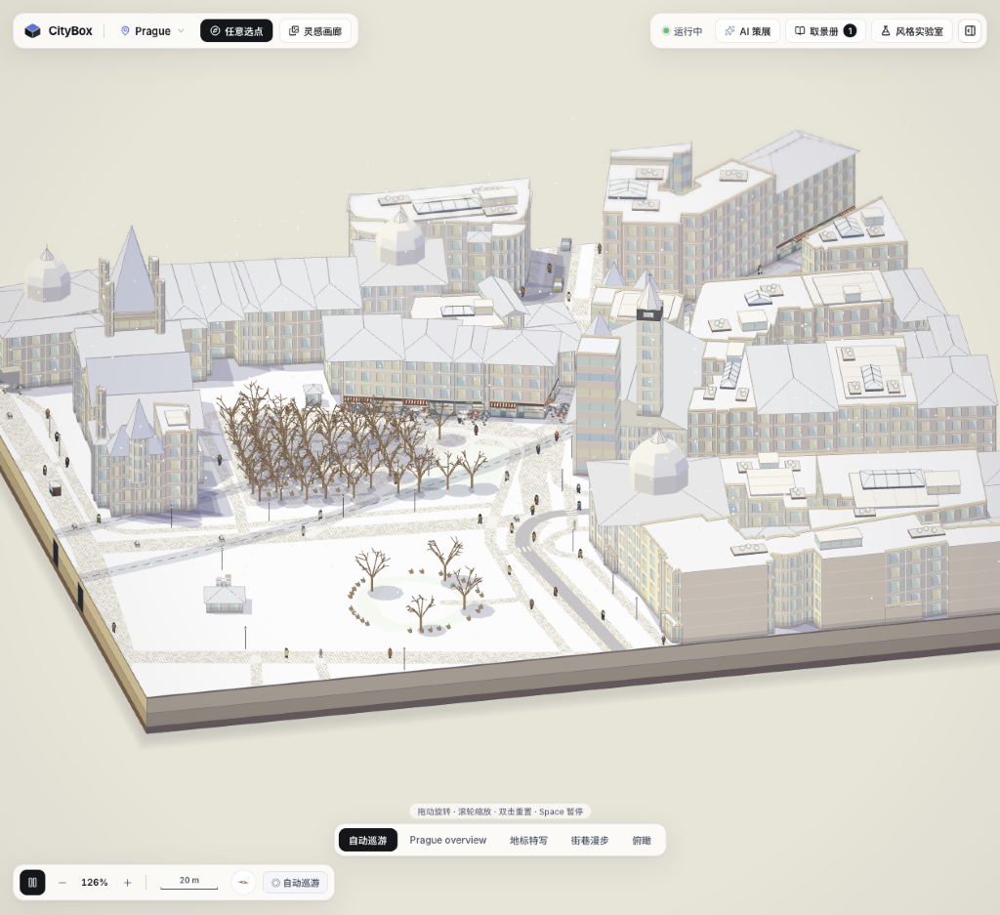
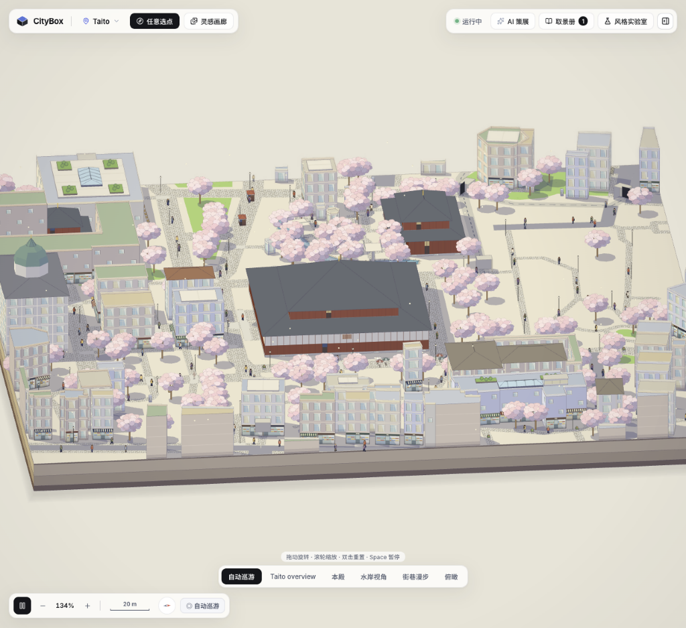
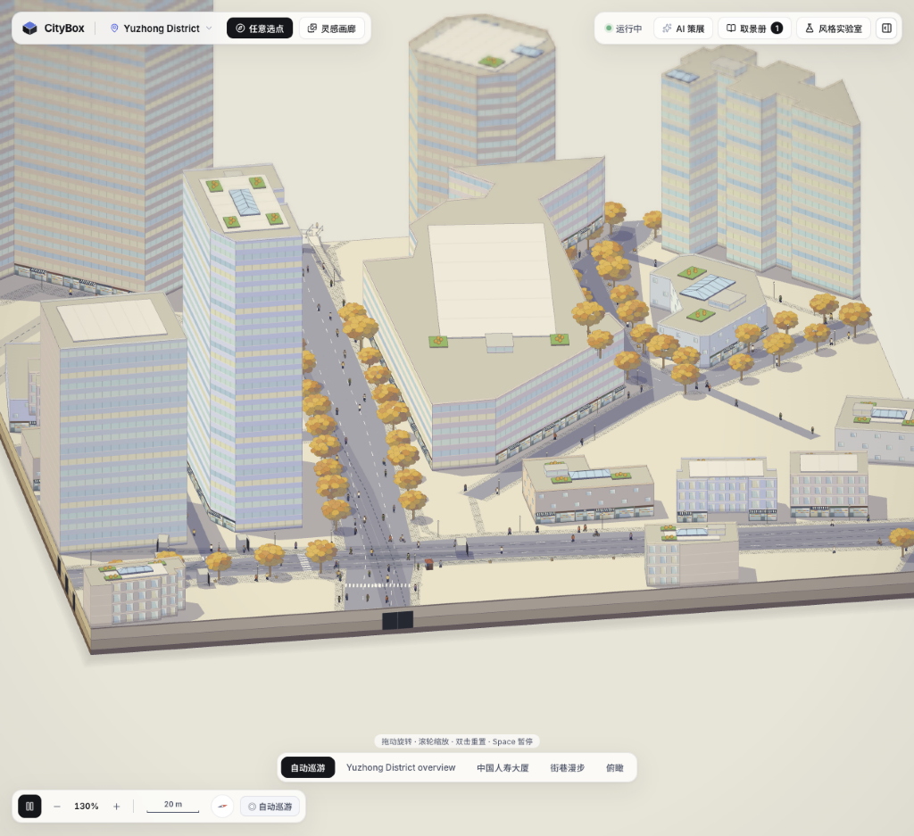
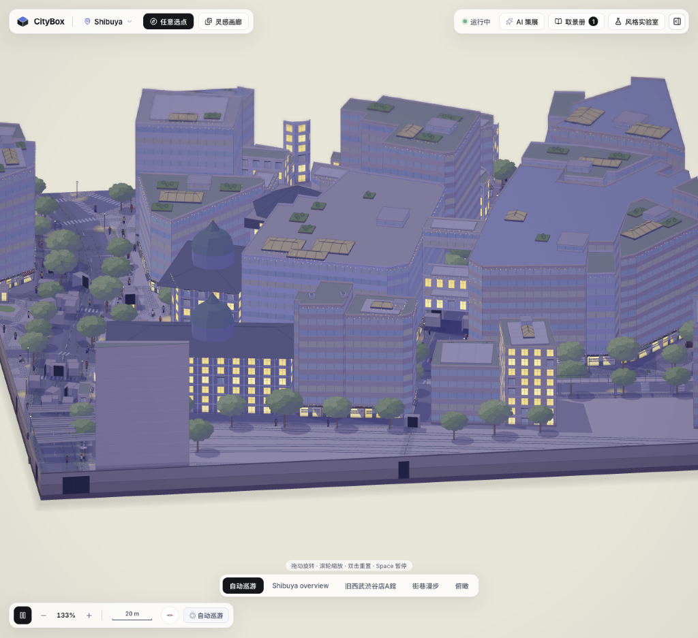
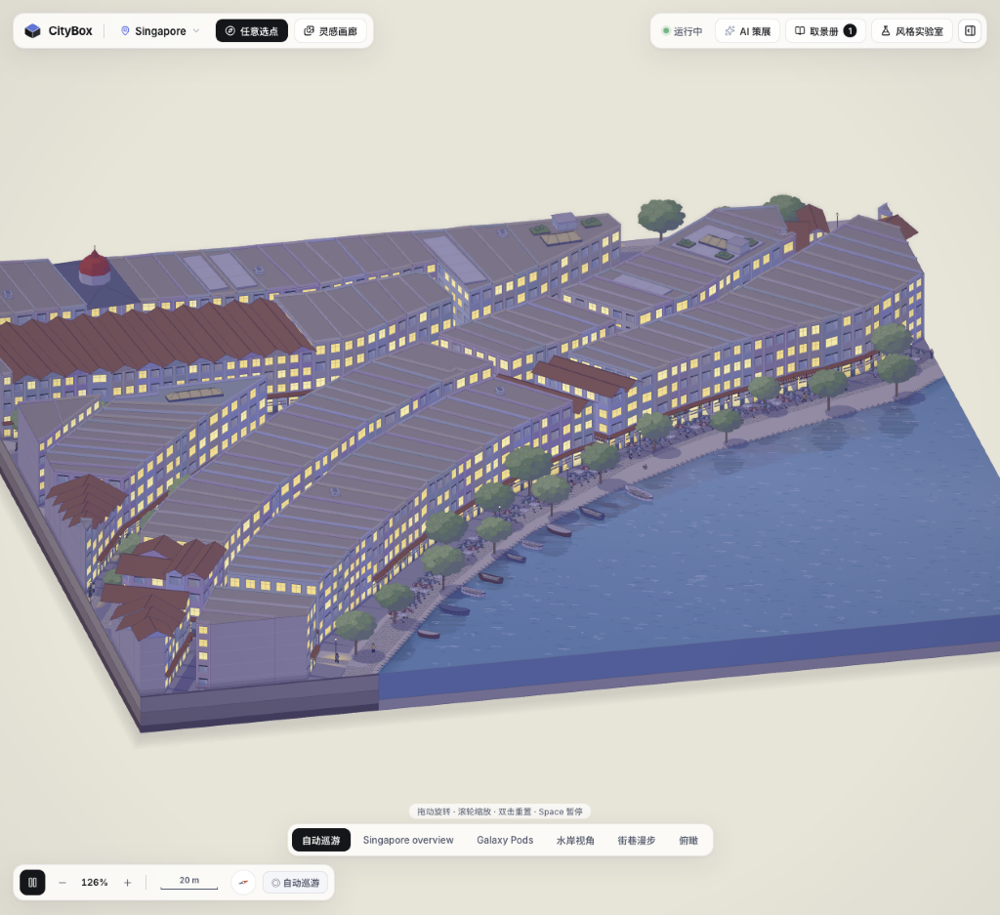
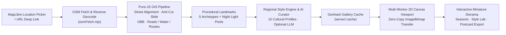

# CityBox · Interactive Miniature City Diorama

**English** | [简体中文](README.md)

> **Turn any real-world block into a living isometric miniature city — powered by a pure-JS OSM GIS pipeline, procedural landmarks, AI style curation, and multi-worker 2D Canvas rendering.**

---

## Global Showcase

All 6 scenes below were generated live by **CityBox** directly from real-world OpenStreetMap coordinates — spanning **Spring Sakura · Summer · Autumn · First Snow · Urban Night · Tropical Night Market**:

| Venice · Rialto Bridge (Summer) | Prague · Old Town Square (First Snow) |
| :---: | :---: |
|  |  |
| **Tokyo · Senso-ji & Nakamise (Spring Sakura)** | **Chongqing · Yuzhong District (Autumn)** |
|  |  |
| **Tokyo · Shibuya (Urban Night)** | **Singapore · Boat Quay (Night Market)** |
|  |  |

---

## Key Features

- **Pick Any Block on Earth**: Built-in interactive MapLibre GL location picker supporting 80m–600m city slices and shareable deep-link URLs (`?lat=...&lng=...&size=200&season=...`).
- **Pure-JS GIS Pipeline (Zero Python Dependencies)**:
  - Live extraction of buildings, roads, waterways, bridges, tunnels, parks, and POIs via OpenStreetMap (Overpass API);
  - Automatic street-bearing alignment (`mod 90°` rotation) and smart sliding window (up to 40% shift) to keep notable landmarks uncut;
  - Building OBB fitting, `building:part` decomposition, carriageway/sidewalk/plaza buffering, moored boats along quays, crosswalks, and animated car/bike/pedestrian routes.
- **Procedural Landmark Modeling**: Automatically detects notable OSM buildings and synthesizes detailed architectural models + night lighting across 5 archetypes (**temples/shrines, churches/belltowers, covered bridges, clock/watch towers, and civic domes**).
- **Regional Style Engine + Optional AI Curator**:
  - 10 built-in regional architectural & climate profiles (historic/modern Japan, historic/modern East Asia, modern Korea, Southeast Asian shophouses, European canals, Mediterranean, classic Europe, and global metro);
  - Optional OpenAI-compatible or Gemini LLM curation for localized palettes, paving styles, foliage, seasonal occasions, and legend notes (with strict schema validation and timeout fallback).
- **High-Performance Multi-Worker Rendering**: Parallel 2–5 Web Worker 2D Canvas rendering with `ImageBitmap` transfer (and automatic main-thread fallback), featuring damped orbit/zoom, smooth camera fly-to presets, cinematic drift, and instant season/night switching.
- **Complete Creative Studio**: Includes an interactive **Style Lab**, **Geohash Gallery Cache**, and **High-Res Postcard PNG Export**.

---

## Architecture



---

## Quick Start

### Prerequisites

- Node.js `>= 20` (`22+` recommended)
- npm `>= 10`

### Run Locally

```bash
# 1. Install dependencies
npm install

# 2. Start the workshop backend server (default: http://127.0.0.1:8787)
npm run server

# 3. In a new terminal, start the frontend dev server (default: http://localhost:5173)
npm run dev
```

Open `http://localhost:5173` in your browser:
- Click **Pick Location** to extract and render any real-world block on the map;
- Open **AI Curator** to optionally connect your own OpenAI-compatible or Gemini API key (works out-of-the-box without an API key via the built-in regional style engine);
- Explore **Style Lab** to compare visual treatments, or open **Postcard** to export high-resolution PNG snapshots.

### Useful Scripts

```bash
npm run dev:server  # Watch mode for the backend server
npm run typecheck   # TypeScript type checking
npm run build       # Production bundle build
```

---

## Project Structure

```text
├── docs/showcase/             # 6 global rendered showcase images
├── server/                    # Pure-ESM Node.js GIS & curation backend
│   ├── index.mjs              # HTTP API server (/api/workshop/generate, /api/gallery, etc.)
│   ├── jobRunner.mjs          # Async extraction job runner & Geohash cache
│   ├── osmFetch.mjs           # OpenStreetMap Overpass fetcher & reverse geocoder
│   ├── planarGeom.mjs         # Pure-JS planar geometry utilities
│   ├── pocketPlot.mjs         # Street alignment & landmark-preserving slide window
│   ├── pocketPrep.mjs         # Buildings, roads, water, trees, boats & routes pipeline
│   ├── pocketLandmarks.mjs    # 5-archetype procedural landmark generator
│   ├── pocketCityConfig.mjs   # 10 regional style & seasonal config synthesizer
│   ├── tileSampler.mjs        # Satellite tile color sampling enrichment
│   ├── aiCurator.mjs          # Optional LLM curator (OpenAI-compatible & Gemini)
│   └── galleryStore.mjs       # Persistent diorama cache & gallery index
└── src/                       # React 19 + TypeScript + Vite frontend
    ├── App.tsx                # Main studio shell, camera controls & URL deep links
    ├── components/            # Viewport, location picker, gallery, AI settings, postcard modal
    ├── lab/                   # Interactive Style Lab
    ├── data/                  # Built-in curated presets
    └── engine/                # Multi-worker 2D Canvas drawing core & third-party notices
```

---

## Credits & License

CityBox builds cleanly on top of the following open-source projects and open data:

- **Underlying 2D Canvas Architectural Drawing Kit**: Vendored MIT-licensed drawing kit by April Zhu (see [src/engine/pocketKit/THIRD_PARTY_LICENSES.md](src/engine/pocketKit/THIRD_PARTY_LICENSES.md) and [src/engine/pocketKit/LICENSE](src/engine/pocketKit/LICENSE)), with figure and isometric foundations derived from Tolga Cohce's `iso-figure`.
- **Map Data**: Live city geometry is © [OpenStreetMap](https://www.openstreetmap.org/copyright) contributors under the Open Database License (ODbL).
- **Mapping & Spatial Libraries**: Powered by [MapLibre GL JS](https://maplibre.org/) and [Turf.js](https://turfjs.org/).

This project is released under the [MIT License](LICENSE).
