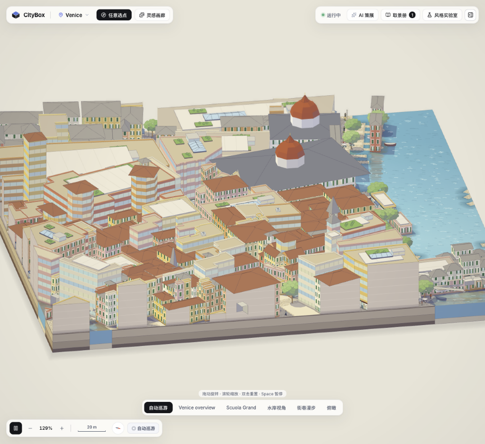
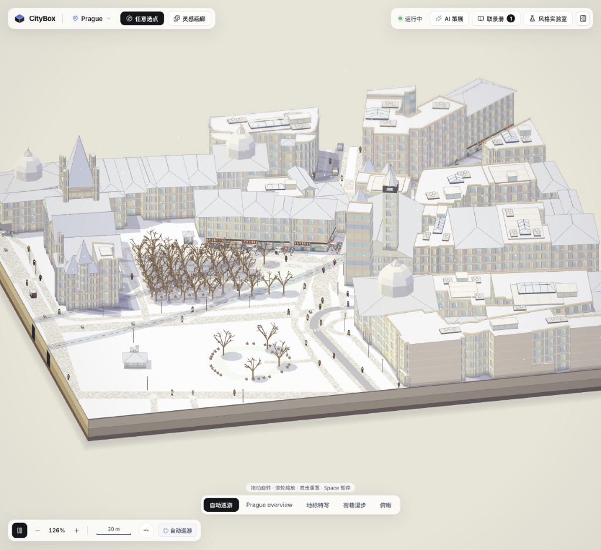
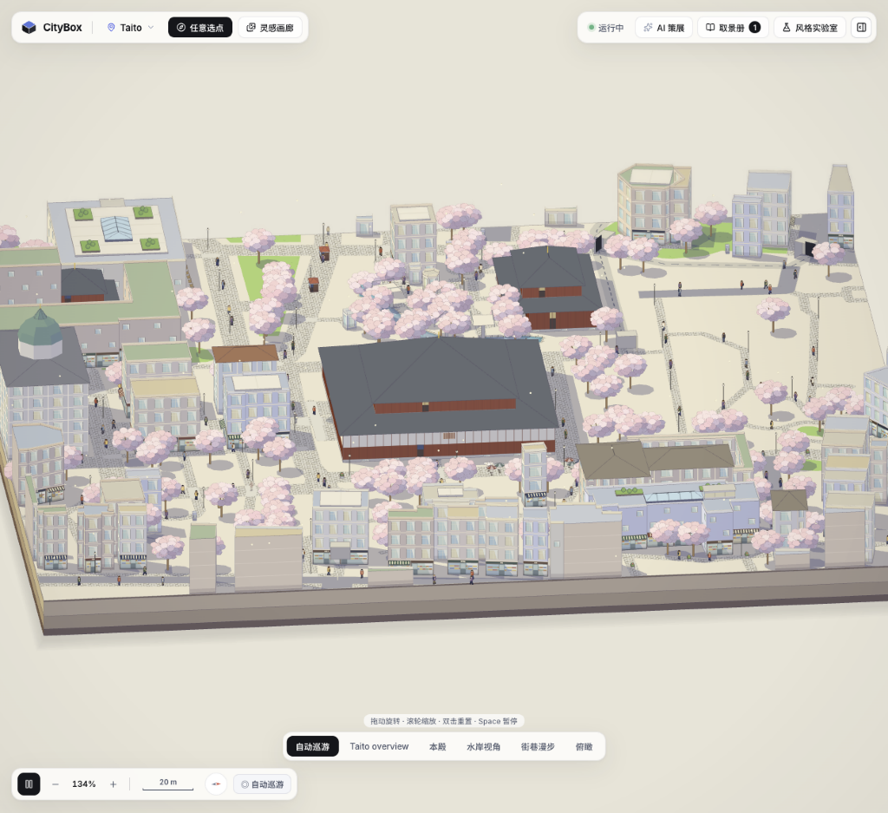
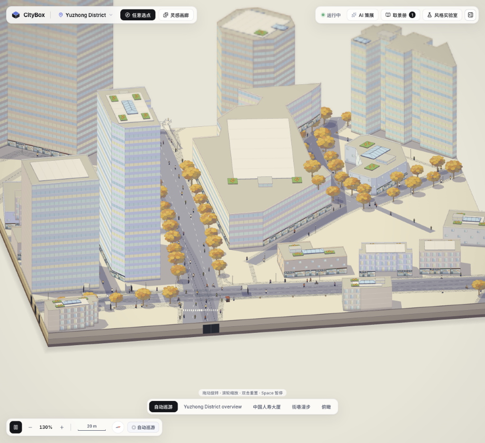
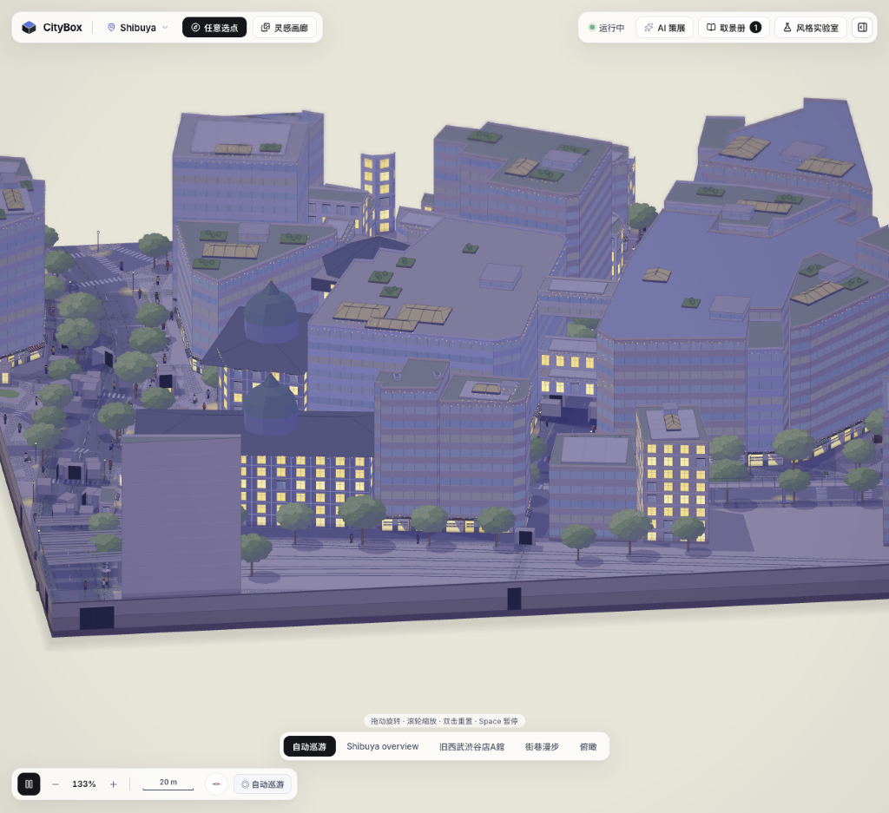
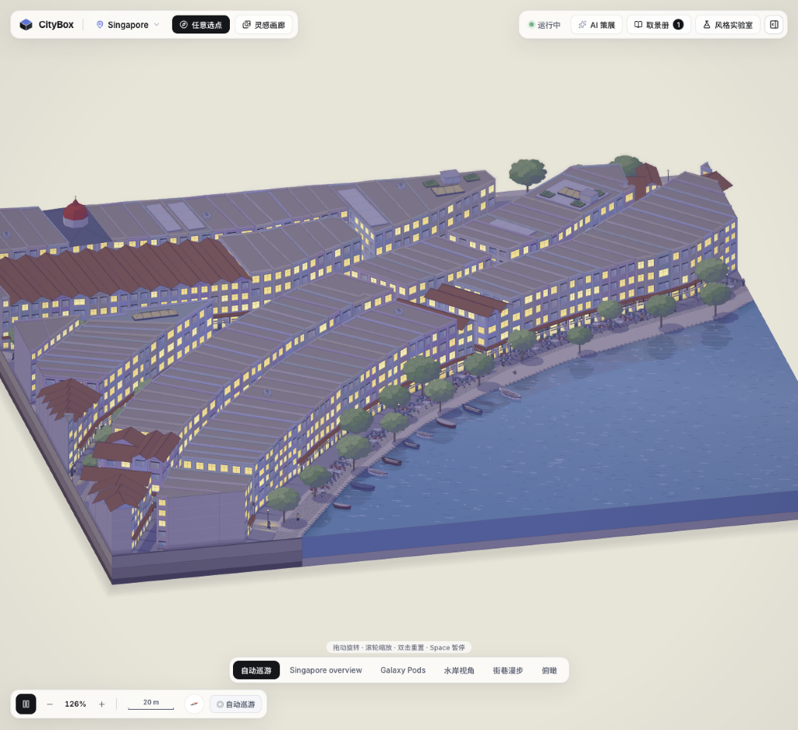
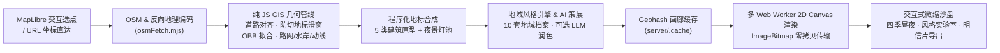

# CityBox · 微缩城市沙盘

**简体中文** | [English](README.en.md)

> **在地图上任选地球上的一个街区，实时将真实 OpenStreetMap 地理数据生成一座会呼吸、有四季昼夜的等轴测微缩城市沙盘。**
>
> *Turn any real-world block into a living isometric miniature city — powered by a pure-JS OSM GIS pipeline, procedural landmarks, AI style curation, and multi-worker 2D Canvas rendering.*

---

## 全球实景生成展示

以下 6 组场景均由 **CityBox** 从真实 OpenStreetMap 经纬度实时提取、程序化建模并渲染，覆盖 **春樱 · 盛夏 · 深秋 · 初雪 · 都市夜巡 · 南洋夜市** 6 种地域肌理与光影氛围：

| 意大利 · 威尼斯里亚托桥（盛夏） | 捷克 · 布拉格老城广场（初雪） |
| :---: | :---: |
|  |  |
| **日本 · 东京浅草寺 & 仲见世通（春樱）** | **中国 · 重庆渝中区（深秋）** |
|  |  |
| **日本 · 东京涩谷（都市夜巡）** | **新加坡 · 驳船码头（南洋夜市）** |
|  |  |

---

## 核心特性

- **任意经纬度实时生成**：内置 MapLibre 交互式地图选点器，支持 80m–600m 切片尺度与 URL 深度链接分享（`?lat=...&lng=...&size=200&season=...`）。
- **零 Python 依赖的纯 JS GIS 处理管线**：
  - 自动从 OpenStreetMap（Overpass API）抓取建筑、路网、水岸、桥梁、隧道、公园绿地与 POI；
  - 主干道朝向自动对齐（`mod 90°` 旋转），并通过滑窗算法（最高 40% 偏移）避免裁切著名地标建筑；
  - 自动完成建筑 OBB 轮廓拟合、`building:part` 拆分、车行道/人行道/步行广场缓冲、水岸泊船、斑马线与行车/骑行/步行路径规划。
- **程序化地标建筑合成**：自动识别 OSM 中的知名建筑，按 **寺庙/神社、教堂/钟楼、廊桥、高塔、穹顶市政建筑** 5 类原型生成精细构件与夜间灯光效果。
- **地域文化风格引擎 + AI 策展（AI Curator）**：
  - 内置 10 套全球地域文化与气候档案（日本古都/现代、东亚古街/都会、韩国都会、南洋骑楼、欧洲运河、地中海、欧陆古典、国际大都会）；
  - 可选接入 OpenAI 兼容或 Gemini 接口进行智能策展，自动生成符合当地特征的配色、铺装、植被、节庆场景与地标导览文案（带严格 Schema 校验与超时降级）。
- **高性能多 Worker 浏览器渲染**：基于 2–5 个 Web Worker 并行绘制 + `ImageBitmap` 传输（支持主线程自动降级），流畅支持阻尼拖拽旋转、滚轮/双指缩放、视角平滑飞跃、自动巡游、四季/夜景切换。
- **创作闭环工具链**：内置 **风格实验室（Style Lab）**、**Geohash 灵感画廊缓存**，以及 **取景册与高清明信片 PNG 导出**。

---

## 系统架构



---

## 快速开始

### 环境要求

- Node.js `>= 20`（推荐 `22+`）
- npm `>= 10`

### 安装与本地运行

```bash
# 1. 安装依赖
npm install

# 2. 启动工坊后端服务（默认监听 http://127.0.0.1:8787）
npm run server

# 3. 新开一个终端，启动前端开发服务（默认 http://localhost:5173）
npm run dev
```

打开浏览器访问 `http://localhost:5173` 即可体验：
- 点击顶部 **任意选点** 在全球地图上框选任意街区实时生成；
- 点击 **AI 策展** 可按需配置自己的 OpenAI 兼容 / Gemini API Key（不配置时默认使用内置确定性地域风格引擎）；
- 点击 **风格实验室** 实时对比不同渲染风格参数，或点击 **取景册** 导出高清明信片 PNG。

### 常用命令

```bash
npm run dev:server  # 监听文件变更自动重启后端
npm run typecheck   # TypeScript 类型检查
npm run build       # 构建生产版本
```

---

## 项目结构

```text
├── docs/showcase/             # 全球 6 大特色场景展示图
├── server/                    # Node.js 纯 ESM 地理与策展工坊后端
│   ├── index.mjs              # HTTP API 网关 (/api/workshop/generate, /api/gallery 等)
│   ├── jobRunner.mjs          # 异步任务队列与 Geohash 缓存调度
│   ├── osmFetch.mjs           # OpenStreetMap Overpass 抓取与反向地理编码
│   ├── planarGeom.mjs         # 纯 JS 平面几何与空间运算工具
│   ├── pocketPlot.mjs         # 道路朝向对齐与防切地标滑窗算法
│   ├── pocketPrep.mjs         # 建筑/道路/水岸/植被/泊船/动线提取管线
│   ├── pocketLandmarks.mjs    # 5 类程序化地标建模器
│   ├── pocketCityConfig.mjs   # 10 套全球地域文化风格与季节配置合成器
│   ├── tileSampler.mjs        # 卫星瓦片色彩采样增强
│   ├── aiCurator.mjs          # 可选 LLM 策展（OpenAI / Gemini 兼容）
│   └── galleryStore.mjs       # 场景持久化缓存与画廊索引
└── src/                       # React 19 + TypeScript + Vite 前端应用
    ├── App.tsx                # 主工作台壳层、视角控制与 URL 深度链接
    ├── components/            # 渲染视口、地图选点、灵感画廊、AI 设置、明信片导出
    ├── lab/                   # 风格实验室（Style Lab）
    ├── data/                  # 内置精选预设场景
    └── engine/                # 多 Worker 2D Canvas 矢量绘制核心与第三方协议声明
```

---

## 致谢与开源协议（Credits & License）

本项目以清晰的边界构建在以下优秀的开源项目与开放数据之上，特此致谢：

- **底层 2D Canvas 建筑矢量绘制套件**：采用 April Zhu 开源的 MIT 协议绘制套件（详见 [src/engine/pocketKit/THIRD_PARTY_LICENSES.md](src/engine/pocketKit/THIRD_PARTY_LICENSES.md) 与 [src/engine/pocketKit/LICENSE](src/engine/pocketKit/LICENSE)），其底层人物与等轴测基础源自 Tolga Cohce 的 `iso-figure`。
- **地理数据**：实时生成的城市数据源自 © [OpenStreetMap](https://www.openstreetmap.org/copyright) contributors（遵循 ODbL 协议）。
- **地图选点组件**：基于 [MapLibre GL JS](https://maplibre.org/) 与 [Turf.js](https://turfjs.org/)。

本项目（CityBox 自身的全栈工作台、纯 JS GIS 处理管线、程序化地标、地域风格引擎与 AI 策展代码）基于 [MIT License](LICENSE) 开源。
